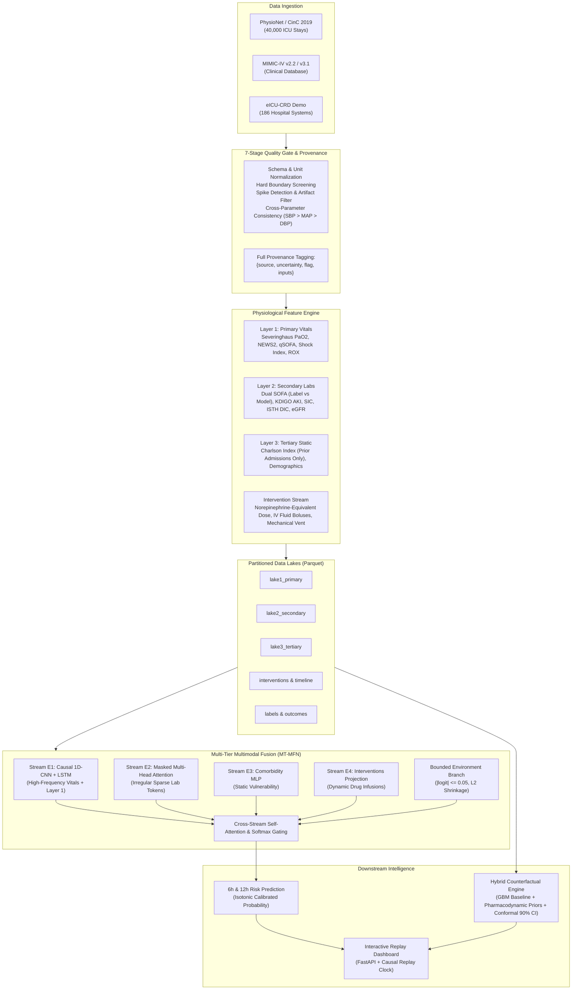

# Sepsis Digital Twin (SDT)
## Real-Time Predictive Critical Care & Counterfactual Simulation Engine

[](https://www.python.org/downloads/)
[](https://opensource.org/licenses/MIT)
[](https://github.com/psf/black)

---

## 1. Executive Summary & Clinical Rationale

Sepsis is a life-threatening organ dysfunction caused by a dysregulated host response to infection. In contemporary Intensive Care Units (ICUs) and acute wards, clinical management is predominantly **reactive**: hemodynamic instability and organ failure are recognized only after overt physiological decompensation has already occurred. Every hour of delay in antibiotic administration and hemodynamic stabilization during septic shock increases in-hospital mortality.

The **Sepsis Digital Twin (SDT)** is an advanced, real-time computational replica of a patient at risk of sepsis. By continuously ingesting high-frequency bedside telemetry, intermittent laboratory panels, clinical intervention records, and baseline electronic health records (EHRs), SDT maintains a continuously updated physiological state space.

### Core Capabilities

1. **Early Onset Forecasting (6h & 12h Horizons):** Forecasts the onset of Sepsis-3 and septic shock **6 to 12 hours in advance** with high sensitivity and clinical lead time, giving critical care teams an actionable window for intervention.
2. **Counterfactual "What-If" Simulation:** Enables physicians to test prospective therapeutic regimens virtually—such as simulating a 500 mL crystalloid fluid bolus or titrating norepinephrine—and inspect the predicted trajectory of mean arterial pressure (MAP) and heart rate (HR) with split-conformal confidence intervals before applying interventions to the physical patient.
3. **Strict Causal Integrity:** Built from the ground up to prevent look-ahead bias and data leakage. Every rolling statistic, imputation model, and neural encoder operates strictly on information available at or before hour $t$.
4. **DECIDE-AI Aligned Silent Mode:** Features an auditable shadow-deployment framework that records prospective alerts without alert fatigue, computing empirical lead times and stream attributions prior to active bedside deployment.

---

## 2. High-Level Architecture & Data Flow



---

## 3. Parameter Taxonomy & Clinical Tiers

The system models over 60 parameters organized into three hierarchical physiological tiers:

### Primary Tier: Real-Time High-Frequency Bedside Telemetry
Updated continuously (minutes to hours). Captures acute rate-of-change and autonomic responses:

| Parameter | Unit | Hard Limits | Extreme Bounds | Max LOCF Age | Clinical Role |
| :--- | :--- | :--- | :--- | :--- | :--- |
| **Heart Rate (HR)** | bpm | $[0, 300]$ | $[30, 200]$ | 2 h | Sustained tachycardia, autonomic stress |
| **Systolic Blood Pressure (SBP)** | mmHg | $[0, 400]$ | $[50, 250]$ | 2 h | Perfusion failure, shock index denominator |
| **Diastolic Blood Pressure (DBP)** | mmHg | $[0, 300]$ | $[20, 150]$ | 2 h | Vascular tone, pulse pressure calculation |
| **Mean Arterial Pressure (MAP)** | mmHg | $[0, 300]$ | $[35, 180]$ | 2 h | Systemic organ perfusion pressure |
| **Respiratory Rate (RR)** | bpm | $[0, 70]$ | $[5, 50]$ | 2 h | Compensatory tachypnea, qSOFA / NEWS2 |
| **Body Temperature** | °C | $[10, 50]$ | $[33, 42]$ | 8 h | Hyperthermia or occult hypothermia |
| **Peripheral Oxygenation ($\text{SpO}_2$)** | % | $[0, 100]$ | $[70, 100]$ | 2 h | Microvascular desaturation |
| **Inspired Oxygen Fraction ($\text{FiO}_2$)** | fraction | $[0.21, 1.0]$ | $[0.21, 1.0]$ | 24 h | Oxygen dependency, P/F calculation |
| **Supplemental $\text{O}_2$ Flow** | L/min | $[0, 80]$ | $[0, 70]$ | 12 h | Nasal cannula titrations |
| **Glasgow Coma Scale (GCS)** | points | $[3, 15]$ | $[3, 15]$ | 8 h | Neurological status (Eye, Verbal, Motor) |
| **Urine Output** | mL | $[-5000, 5000]$ | — | 1 h | Renal excretion rate, KDIGO AKI staging |

### Secondary Tier: Intermittent Laboratory Biomarkers
Charted intermittently (every 1 to 24 hours). Quantifies tissue hypoperfusion, organ dysfunction, and coagulopathy:

| Parameter | Unit | Hard Limits | Extreme Bounds | Max LOCF Age | Clinical Interpretation |
| :--- | :--- | :--- | :--- | :--- | :--- |
| **Blood Lactate** | mmol/L | $[0.1, 40]$ | $[0.3, 15]$ | 12 h | Anaerobic metabolism, cellular hypoxia |
| **Arterial pH** | pH units | $[6.5, 8.0]$ | $[6.9, 7.7]$ | 12 h | Systemic acidemia progression |
| **Serum Bicarbonate** | mmol/L | $[1, 70]$ | $[8, 45]$ | 24 h | Metabolic acidosis compensation |
| **Base Excess** | mmol/L | $[-40, 40]$ | $[-20, 20]$ | 12 h | Metabolic reserve deficit |
| **Arterial $\text{PaO}_2$** | mmHg | $[10, 800]$ | $[40, 600]$ | 6 h | Arterial oxygen tension (blood gas) |
| **Arterial $\text{PaCO}_2$** | mmHg | $[5, 200]$ | $[20, 100]$ | 6 h | Alveolar ventilation, hypercapnia |
| **Serum Creatinine** | mg/dL | $[0.05, 30]$ | $[0.2, 12]$ | 48 h | Acute kidney injury, filtration failure |
| **Blood Urea Nitrogen (BUN)**| mg/dL | $[1, 300]$ | $[2, 150]$ | 48 h | Renal azotemia, catabolism |
| **Total Bilirubin** | mg/dL | $[0.05, 80]$ | $[0.1, 30]$ | 48 h | Hepatic clearance failure (SOFA liver) |
| **Platelet Count** | $\text{K}/\mu\text{L}$ | $[1, 3000]$ | $[10, 1000]$ | 48 h | Consumptive coagulopathy, DIC |
| **White Blood Cells (WBC)** | $\text{K}/\mu\text{L}$ | $[0.01, 500]$ | $[0.5, 100]$ | 48 h | Leukocytosis / leukopenia |
| **C-Reactive Protein (CRP)** | mg/L | $[0, 1000]$ | — | 72 h | Systemic inflammatory response |
| **Fibrinogen** | mg/dL | $[10, 2000]$ | $[80, 900]$ | 48 h | Consumption coagulopathy |
| **D-Dimer** | ng/mL | $[1, 100000]$ | — | 72 h | Microvascular thrombosis / fibrinolysis |
| **Prothrombin Time / INR** | sec / ratio | $[5, 200] / [0.5, 25]$ | $[9, 80] / [0.8, 8]$ | 48 h | Extrinsic coagulation cascade failure |

### Tertiary Tier: Static Demographics, Comorbidities & Interventions
- **Demographics:** Age, biological sex, admission source, ICU unit type (MICU, SICU, CCU).
- **Charlson Comorbidity Index (CCI):** Calculated strictly from **prior hospital admissions** (ICD-9/10 algorithms of Quan et al., 2005) across 17 clinical conditions to prevent discharge summary leakage.
- **Interventions:** 
  - *Vasopressors:* Norepinephrine, Epinephrine, Vasopressin, Phenylephrine, Dopamine mapped to a unified **Norepinephrine-Equivalent Dose (NED)** in $\mu\text{g/kg/min}$ (Goradia et al., 2021).
  - *IV Fluids:* Hourly infusion and bolus volumes (crystalloids, colloids).
  - *Ventilation:* Invasive mechanical ventilation vs. non-invasive ventilation flags.
- **Environmental Exposures (Bounded):** Ambient $\text{PM}_{2.5}$, temperature, and humidity capped at $\pm 0.05$ logit with strong $L_2$ shrinkage.

---

## 4. Derived Clinical Scores & Mathematical Formulations

To provide immediate clinical relevance, the pipeline computes validated derived indices at each timeline hour:

1. **Severinghaus Inversion for $\text{PaO}_2$ Estimation (Ellis Method):**
   When arterial blood gas $\text{PaO}_2$ is unmeasured and $\text{SpO}_2 \le 96\%$, $\text{PaO}_2$ is estimated using the non-linear inversion of the Severinghaus dissociation curve (Brown et al., 2016):
   $$a = \frac{11700}{\frac{1}{S} - 1}, \quad b = \sqrt{50^3 + a^2}, \quad \widehat{\text{PaO}}_2 = \sqrt[3]{a + b} + \sqrt[3]{a - b}$$
   *(where $S = \text{SpO}_2 / 100$)*.
2. **Effective $\text{FiO}_2$ (`fio2_eff`):**
   Measured fraction if charted; otherwise approximated for nasal cannula as $0.21 + 0.04 \times \text{Flow}_{\text{LPM}}$ (up to 6 L/min); defaults to room air ($0.21$) when unassisted. Every value records its provenance (`measured`, `model_estimate`, or `assumed`).
3. **Dual Sequential Organ Failure Assessment (SOFA):**
   - `sofa_label`: Evaluates Respiration, Coagulation, Liver, Cardiovascular, CNS, and Renal sub-scores using **strictly measured values** (blood gas $\text{PaO}_2$ required). Used exclusively to construct training labels.
   - `sofa`: Permits SpO2-derived $\text{PaO}_2/\text{FiO}_2$ approximations in the respiratory domain. Used as a model input feature.
4. **Renal KDIGO AKI Staging:**
   Combines rolling 48-hour creatinine changes relative to the minimum historical baseline with weight-indexed rolling 6h, 12h, and 24h urine output rates ($\text{mL/kg/h}$).
5. **Hemodynamic & Oxygenation Indices:**
   - **Shock Index:** $\text{SI} = \frac{\text{Heart Rate}}{\text{Systolic BP}}$
   - **Pulse Pressure:** $\text{PP} = \text{SBP} - \text{DBP}$
   - **ROX Index:** $\text{ROX} = \frac{\text{SpO}_2 / \text{FiO}_2}{\text{Respiratory Rate}}$
   - **NEWS2 & qSOFA:** Standardized bedside early warning aggregations.
6. **Coagulopathy Indices:**
   - **Sepsis-Induced Coagulopathy (SIC):** Evaluates platelets, INR, and four-organ SOFA (Iba et al., 2017).
   - **ISTH Overt DIC Score:** Taylor et al. (2001) consensus scoring.

---

## 5. End-to-End Implementation Phases

```
┌──────────────────────────────────────────────────────────────────────────────────┐
│  Phase 1 & 2: Data Foundation, Quality Gate, Data Lakes & Sepsis-3 Labels        │
│  Phase 3: Causal Forward-Only Imputation & Pre-training                          │
│  Phase 4: Multimodal Fusion Network (MT-MFN) & Multi-Center Validation           │
│  Phase 5: Counterfactual What-If Simulation Engine                               │
│  Phase 6: Wearable Telemetry Integration & DECIDE-AI Silent Shadow Deployment    │
└──────────────────────────────────────────────────────────────────────────────────┘
```

### Phases 1 & 2: ICU Foundation, Data Lakes, and Sepsis-3 Labels
- **Data Ingestion:** High-speed streaming parser with DuckDB and PyArrow backends supporting PhysioNet 2019, MIMIC-IV, and eICU.
- **7-Stage Quality Gate:** Filters impossible physiology, screens duplicate records, flags extreme but valid values, identifies transient telemetry spikes, and removes out-of-stay entries.
- **Row-Level Provenance Schema:**
  Every row in `lake1_primary` and `lake2_secondary` carries:
  `[stay_id, charttime, param, value, unit, source, uncertainty, flag, qc_reason, inputs, itemid, pipeline_version]`
- **Sepsis-3 Consensus Labeling:**
  Identifies suspected infection events (antibiotic within 72h after culture or culture within 24h after antibiotic) and matches them with a 2-point increase in measured `sofa_label` within a $[-48\text{h}, +24\text{h}]$ window. Septic shock requires sepsis, concurrent vasopressors, and lactate $> 2.0\text{ mmol/L}$.

### Phase 3: Causal Forward-Only Imputation
- Traditional bidirectional imputers (like BRITS or MICE) utilize future measurements to reconstruct past states—introducing severe leakage in prospective monitoring.
- SDT implements `CausalGRUImputer`: a right-shifted GRU that predicts vitals at hour $t$ using **only hours $< t$**, outputting a Gaussian mean and variance.
- **Mask-and-Recover Validation:** Validated by holding out real observed measurements under three stress distributions:
  1. *MCAR (Missing Completely at Random):* Random missingness.
  2. *Contiguous Multi-Hour Blocks:* Simulating sensor disconnection.
  3. *MNAR (Missing Not at Random):* Missingness conditioned on extreme underlying values.

### Phase 4: Multi-Tier Multimodal Fusion Network (MT-MFN)
- **Stream E1 (Vitals):** Left-padded causal 1D-CNN over continuous telemetry followed by an LSTM to capture dynamic rate-of-change.
- **Stream E2 (Labs):** Treats intermittent laboratory observations as sparse tokens $(t_i, p_i, v_i)$ embedded with sinusoidal temporal representations and passed through causal masked self-attention.
- **Stream E3 (Static Baseline):** Dense MLP embeddings for baseline demographics and comorbidity risks.
- **Stream E4 (Interventions):** Hourly vasopressor rates and fluid volumes.
- **Dynamic Stream Gating:** Cross-stream multi-head attention computes a softmax distribution over stream contributions for each individual hour, providing continuous explainability.
- **Calibration:** Non-parametric isotonic regression mapping raw logits to well-calibrated probabilities.

### Phase 5: Counterfactual "What-If" Simulation Engine
- **The ICU Confounding Challenge:** In observational ICU data, vasopressors are continuously titrated to a target blood pressure within the same hour, causing drug dose and pressure changes to cancel out. Standard regression or Double Machine Learning (DML) falsely estimates negligible treatment effect ($< 0.2\text{ mmHg}$).
- **The Hybrid Solution:**
  1. *Factual Course:* A gradient-boosting model (`HistGradientBoostingRegressor`) predicts MAP and HR under usual care.
  2. *Split Conformal Calibration:* Calibrated on held-out ICU stays to produce guaranteed 90% confidence bands.
  3. *Published Pharmacodynamic Priors:*
     - **Fluid Bolus:** $+5\text{ mmHg}$ per $500\text{ mL}$ bolus decaying across hours with weights $[1.0, 0.43, 0.15]$ (Glassford et al., 2014).
     - **Norepinephrine:** $+20\text{ mmHg}$ per $0.1\ \mu\text{g/kg/min}$ NED sustained during active infusion (Adda et al., 2021).
  4. *Clinical Safety Guardrails:* Automatically refuses counterfactual plans that propose doses outside observed clinical safety envelopes, boluses $> 1000\text{ mL}$, or rapid unsafe titrations.

### Phase 6: Wearables & DECIDE-AI Silent Deployment
- **Wearable Ingestion:** Ingestion of continuous beat-to-beat ($RR$) intervals with a Signal Quality Index (SQI) filter removing non-physiological beats ($< 300\text{ ms}$ or $> 2000\text{ ms}$) and $> 20\%$ ectopic jumps. Computes time-domain Heart Rate Variability (HRV: RMSSD, SDNN, pNN50).
- **Silent Shadow Deployment (`ShadowRunner`):** Runs prospective inference in parallel with routine ICU care, generating structured audit logs of would-be alerts and lead times without alerting clinicians.
- **Causality Proof:** Rigorous unit tests confirm that truncating an ICU stay at hour $t$ produces predictions identical to the full timeline evaluated up to $t$ ($\Delta \text{risk} = 0.0000$).

---

## 6. Empirical Validation & Benchmark Results

The architecture has undergone internal validation on **PhysioNet/CinC 2019 Hospital System A** and prospective external validation on **Hospital System B** (representing distinct EHR platforms, clinical practices, and patient populations):

### Risk Prediction Performance (External Test Set B — 19,777 Stays, 759,345 Hours)

| Prediction Horizon | AUROC (95% CI) | AUPRC (95% CI) | Septic Stays Detected | Median Clinical Lead Time | Alerts / Patient-Day |
| :---: | :---: | :---: | :---: | :---: | :---: |
| **6 Hours Ahead** | **0.784** $[0.768, 0.798]$ | **0.038** $[0.033, 0.045]$ | **80.7%** | **12.0 Hours** | **6.6** |
| **12 Hours Ahead** | **0.760** $[0.742, 0.776]$ | **0.066** $[0.059, 0.073]$ | **79.7%** | **12.0 Hours** | **7.0** |

*Note: On Internal Hospital A test data (3,023 stays), the model achieves AUROC **0.825** (6h) and **0.814** (12h) with **91.3%** stay detection.*

### Stream Importance & Feature Attribution (External Test Set B)

| Data Stream | Mean Softmax Gate Weight | AUROC Drop When Removed (Ablation) |
| :--- | :---: | :---: |
| **Stream E1 (Bedside Vitals & Layer 1)** | 58.7% | $-0.061$ |
| **Stream E2 (Irregular Labs & Layer 2)** | 11.0% | **$-0.111$** |
| **Stream E3 (Static Baseline & Comorbidities)** | 30.3% | $-0.004$ |

*Insight:* Although intermittent labs are charted less frequently (accounting for 11% of average temporal attention), removing them causes the single largest collapse in predictive discrimination ($-0.111$ AUROC drop), proving the necessity of multimodal fusion.

### Causal Imputation Benchmark (`CausalGRUImputer`)
- **90% Interval Coverage:** Median **92.1%** (well-calibrated uncertainty).
- **LOCF Comparison:** Causal GRU outperformed Last Observation Carried Forward (LOCF) in **95.8%** of test series, reducing mean absolute error by **9.5%**.

### What-If Simulation Engine Accuracy
- **Factual MAP Forecast Error:** $8.3\text{ mmHg}$ Mean Absolute Error (vs. $9.0\text{ mmHg}$ for baseline carry-forward).
- **Conformal Interval Coverage:** $87\%\text{--}90\%$ empirical coverage on held-out patient cohorts.

---

## 7. Interactive Clinical Dashboard

The project includes an interactive web dashboard built with a **FastAPI** backend and modern **vanilla JavaScript/CSS** frontend:

```
http://127.0.0.1:8050
```

### Key Dashboard Capabilities
- **Causal Replay Clock:** Scrub hour-by-hour through any ICU stay. The server mathematically guarantees that no data after the selected replay hour is ever transmitted to the client.
- **Triage Patient List:** Real-time patient census ranked by 6-hour sepsis risk, showing active alerts, current vitals, and dominant contributing streams.
- **Individual Patient Trajectory:**
  - Dynamic risk curves for 6h and 12h onset horizons with threshold bands.
  - Multi-stream attention allocation area charts (Vitals vs. Labs vs. Static).
  - Synchronized high-frequency telemetry sparklines.
  - Intermittent laboratory panels with outlier and critical flag markers.
  - Organ dysfunction meters (SOFA, KDIGO, Shock Index).
- **Counterfactual What-If Panel:** Test fluid boluses and vasopressor titrations to preview projected MAP and HR trajectories with 90% confidence bands against usual care.
- **Interactive Model Card & Educational Mode:** Inspect live AUROC/AUPRC metrics, calibration slopes, decision curves, and toggle ground-truth outcome reveals for retrospective case reviews.

---

## 8. Installation & Quickstart

### Prerequisites
- Python 3.10, 3.11, or 3.12
- PyTorch $\ge 2.0$
- Modern browser (Chrome, Edge, Firefox, Safari)

### 1. Environment Setup

```bash
# Clone the repository
git clone https://github.com/your-org/Sepsis_DT.git
cd Sepsis_DT

# Create and activate a virtual environment
python -m venv .venv
source .venv/bin/activate        # On Linux / macOS
# .\.venv\Scripts\Activate.ps1   # On Windows PowerShell

# Install package in editable mode with development dependencies
pip install -e ".[dev]" torch scikit-learn
```

### 2. End-to-End Pipeline Execution (Open PhysioNet 2019 Data)

No clinical credentialing is required to run the pipeline on the open PhysioNet 2019 dataset (~40,000 ICU stays):

```bash
# Step 1: Download PhysioNet 2019 files with MD5 verification
python scripts/download_physionet2019.py

# Step 2: Run Phases 1-2 (Quality gate, feature derivation, data lakes)
python scripts/run_physionet_pipeline.py

# Step 3: Run Phases 3-4 (Causal imputer training, MT-MFN fusion model training & validation)
python scripts/run_phase3_4.py

# Step 4: Run Phase 5 (Counterfactual What-If engine training & conformal calibration)
python scripts/run_phase5_whatif.py

# Step 5: Run Phase 6 (Prospective silent mode replay & DECIDE-AI summary)
python scripts/run_phase6_silent.py
```

### 3. Running with MIMIC-IV and eICU Data

- **MIMIC-IV Open 100-Patient Demo:**
  ```bash
  wget -r -N -c -np -nH --cut-dirs=1 -P data/raw https://physionet.org/files/mimic-iv-demo/2.2/
  python scripts/run_pipeline.py
  ```
- **eICU-CRD Demo (Enables What-If Engine):**
  ```bash
  python scripts/run_eicu_pipeline.py
  python scripts/run_whatif_v2.py
  ```

### 4. Launching the Interactive Dashboard

```bash
python -m sdt.dashboard.app
# Open your browser at http://127.0.0.1:8050
# API documentation available at http://127.0.0.1:8050/api/docs
```

### 5. Running the Test Suite

```bash
# Run all unit tests for formulas, gates, labels, and causality
python -m pytest
```

---

## 9. Repository Structure

```
.
├── config/                         # Configuration specifications
│   ├── parameters.yaml             # Complete parameter catalogue, itemids, limits
│   ├── interventions.yaml          # Drug classes, vasopressor NED conversion factors
│   ├── physionet2019.yaml          # PhysioNet challenge column mappings & schema
│   └── settings.yaml               # Pipeline execution horizons and environment caps
├── data/                           # Data lakes & model checkpoints
│   ├── physionet2019/              # Lakes, trained models, and validation reports
│   ├── whatif/                     # What-if engine checkpoints and conformal weights
│   └── raw/                        # Staged raw clinical datasets
├── scripts/                        # Pipeline execution entry points
│   ├── download_physionet2019.py   # Automated dataset downloader
│   ├── run_physionet_pipeline.py   # Run Phases 1-2 on PhysioNet data
│   ├── run_phase3_4.py             # Train causal imputer and fusion model
│   ├── run_phase5_whatif.py        # Train Phase 5 counterfactual engine
│   ├── run_whatif_v2.py            # Train Phase 5 v2 hybrid counterfactual engine
│   ├── run_phase6_silent.py        # Run Phase 6 silent deployment verification
│   └── reconcile_sepsis3.py        # MIT-LCP Sepsis-3 consensus label reconciler
├── src/sdt/                        # Core Python library
│   ├── quality/gate.py             # 7-stage quality gate & artifact detection
│   ├── derive/                     # Layer 1, Layer 2, Layer 3 & intervention math
│   ├── labels/sepsis3.py           # Sepsis-3 consensus ground-truth labeling
│   ├── lake/store.py               # Parquet lake storage & provenance writer
│   ├── model/                      # PyTorch neural fusion, imputer, and evaluation
│   ├── whatif/hybrid.py            # Hybrid counterfactual simulation engine
│   ├── wearable/hrv.py             # ECG/PPG beat cleaning and HRV metrics
│   ├── deploy/silent.py            # DECIDE-AI silent mode runner & causality audit
│   └── dashboard/                  # FastAPI service and single-page web application
├── tests/                          # Pytest test suite
│   ├── test_formulas.py            # Unit tests for clinical formulas
│   ├── test_gate_and_labels.py     # Quality gate and Sepsis-3 label verification
│   ├── test_phase5_6.py            # Imputer, wearable, and causality unit tests
│   └── test_whatif_v2.py           # What-if simulation and guardrail tests
├── pyproject.toml                  # Python package build configuration
└── README.md                       # Comprehensive project documentation
```

---

## 10. Clinical Safety, Scope Limits & Regulatory Governance

> [!IMPORTANT]
> **Research & Decision-Support Notice:**
> The Sepsis Digital Twin (SDT) is an investigational decision-support research system. It is **not** an autonomous medical device, diagnostic instrument, or clinical dosing calculator.

1. **Unmeasured Confounding & Causal Limits:**
   The What-If simulation engine assumes additive treatment effects and absence of unmeasured confounding. Because observational ICU records suffer from titration confounding, treatment effect sizes are anchored to published prospective clinical trials (Glassford et al., 2014; Adda et al., 2021).
2. **Clinical Guardrails:**
   The simulation engine automatically rejects user inputs proposing fluid boluses exceeding $1000\text{ mL}$, vasopressor titrations outside observed clinical distributions, or states incompatible with human physiology.
3. **DECIDE-AI Protocol:**
   Before prospective bedside deployment, the system must undergo silent-mode evaluation in accordance with the DECIDE-AI guidelines to evaluate prospective alert burden, clinician workflow integration, and lead times.
4. **Local Recalibration:**
   Baseline risk varies substantially across institutions. When deploying to a new hospital system, isotonic risk calibration and laboratory assay thresholds (such as local D-Dimer and troponin assays) must be recalibrated on historical local cohorts.

---

## 11. References & Scientific Citations

- **Sepsis-3 Consensus:** Singer M, et al. *"The Third International Consensus Definitions for Sepsis and Septic Shock (Sepsis-3)."* **JAMA**, 2016; 315(8):801–810.
- **Infection Suspicion Window:** Seymour CW, et al. *"Assessment of Clinical Criteria for Sepsis."* **JAMA**, 2016; 315(8):762–774.
- **Ellis Severinghaus Inversion:** Brown SM, et al. *"Nonlinear Imputation of PaO2/FiO2 From SpO2/FiO2 Among Patients With Sepsis."* **Chest**, 2016; 150(2):307–313.
- **PhysioNet/CinC Challenge 2019:** Reyna MA, et al. *"Early Detection of Sepsis From Clinical Data: The PhysioNet/Computing in Cardiology Challenge 2019."* **Crit Care Med**, 2020; 48(2):e58–e65.
- **Fluid Response Kinetics:** Glassford NJ, et al. *"Physiological changes after fluid bolus therapy in sepsis: a systematic review of contemporary data."* **Crit Care**, 2014; 18(6):696.
- **Vasopressor Dynamics:** Adda M, et al. *"Hemodynamic effects of norepinephrine titration in septic shock."* **Ann Intensive Care**, 2021; 11(1):122.
- **Norepinephrine Equivalency:** Goradia S, et al. *"Validation of a norepinephrine equivalent score in septic shock."* **J Crit Care**, 2021; 64:148–153.
- **Conformal Prediction:** Lei J, et al. *"Distribution-free predictive inference for regression."* **J Am Stat Assoc**, 2018; 113(523):1094–1111.
- **DECIDE-AI:** Vasey B, et al. *"Reporting guideline for the early-stage clinical evaluation of decision support systems driven by artificial intelligence: DECIDE-AI."* **BMJ**, 2022; 377:e070904.
